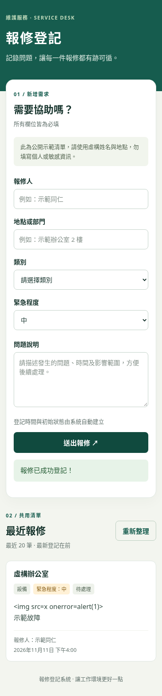
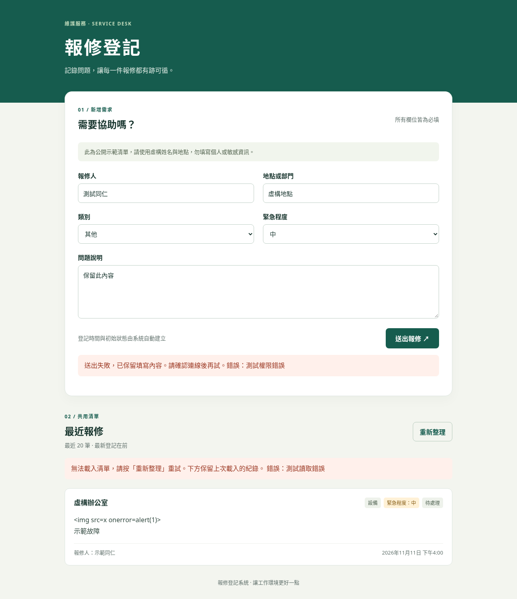
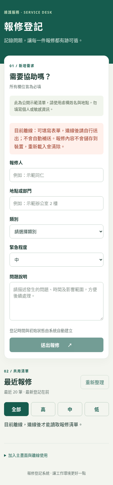

# 報修登記系統
提供報修需求登記與查閱共用報修清單的功能。

[報修欄位表與範例資料](文件/報修欄位表.xlsx)

[報修系統操作說明（Word）](文件/報修系統操作說明.docx)

[報修登記系統提案（PowerPoint，6 頁）](文件/報修登記系統提案.pptx)

## 網頁前端

首頁為根目錄 `index.html`，樣式與行為分別在 `style.css`、`app.js`；`config.js` 只有 Supabase 專案網址與公開 publishable key。使用本機隨附的 Supabase JS 2.119.0（`vendor/`，含 MIT 授權），無須建置，也不必連到 CDN 才能開啟表單。

請先在 Supabase 部署 `supabase/schema.sql`，確認 RLS 與 anon 權限。前端只新增 reporter_name、location、category、description、urgency；status 與 created_at 由資料庫產生。清單公開讀取最新 20 筆，時間以台北時區顯示。請僅使用虛構資料。

本機啟動（在儲存庫根目錄）：

```sh
python3 -m http.server 8000
```

開啟 http://localhost:8000 。GitHub Pages 請設定 Settings → Pages → Deploy from a branch → main → / (root)，預期網址為 https://trrtms46m7-cloud.github.io/Daya/ 。

## 驗證

語法與空白檢查：

```sh
node --check app.js
node --check config.js
node --check pwa.js
node --check sw.js
git diff --check
```

瀏覽器測試位於 `tests/frontend.cjs`，使用真正的 SDK 與模擬 API，不會新增真實資料。需有 Node.js、Playwright、`/usr/bin/chromium`，並先啟動上述 8000 埠伺服器：

```sh
npm install --no-save --package-lock=false playwright
node tests/frontend.cjs
node tests/pwa.cjs
```

測試涵蓋手機與桌面無水平溢出、五欄位新增（不含 status）、排序與 20 筆限制、成功訊息、讀取失敗重試、送出失敗保留內容與安全文字顯示。畫面截圖：





本次環境的網路政策阻擋 Supabase 網域，因此尚未驗證實際資料庫新增、讀取及 RLS。正式使用前，以虛構資料送出並確認清單中的自動時間與「待處理」狀態；使用公開 client 檢查 INSERT/SELECT 可用，UPDATE/DELETE 被拒。請勿將 secret 或 service_role 金鑰放進前端。

## 報修清單緊急程度篩選

清單上方新增「全部、高、中、低」按鈕，預設為「全部」。選中的按鈕以深綠底白字呈現，並提供 aria-pressed 狀態；「高」緊急程度標籤改為紅色。篩選只使用網頁已讀取的最近 20 筆，不會額外查詢資料庫；沒有符合項目時會顯示提示。重新整理或送出成功後會保留目前篩選。

本次只調整網頁、前端驗證與說明，沒有修改資料庫、新增欄位或變更 supabase 資料夾。

手機確認方式：開啟此分支的預覽或本機網頁，滑到「最近報修」，確認預設選中「全部」。依序點「高、中、低」，確認只顯示對應項目且選中按鈕明顯；點「全部」恢復清單。「高」標籤應為紅色，沒有符合資料時應顯示提示；按鈕與卡片不應造成水平捲動。PR 合併部署前，main 的正式網站不會包含本次變更。

## PWA：安裝與離線使用

透過 HTTPS（例如 GitHub Pages）或 `http://localhost:8000` 開啟。直接開啟 `file://` 不支援 Service Worker。`manifest.webmanifest` 定義名稱、獨立視窗與 192／512 像素圖示；另提供 maskable 與 Apple 主畫面圖示。所有路徑皆相對於專案，可部署在 `/Daya/` 子目錄。

- Android、桌面 Chrome／Edge：瀏覽器允許安裝時，頁尾會出現「安裝報修登記」；也可使用瀏覽器選單的安裝功能。
- iPhone／iPad：在 Safari 點「分享」→「加入主畫面」。實際選項及安裝資格依瀏覽器而異，不能保證每個瀏覽器都顯示按鈕。
- 首次連線且 Service Worker 完成快取後，可離線重新開啟表單。離線時停用送出與重新整理，並顯示提示；重新連線會重讀清單，但不會自動送出表單。
- 送出報修與取得最新清單仍需要網路。沒有背景同步或離線送出佇列。草稿只在目前頁面記憶體中，關閉或重新載入會清除；離線前本頁已載入的清單會標示可能不是最新，離線重新開啟則不顯示舊報修紀錄。

`pwa.js` 處理安裝入口及 Service Worker 註冊；`sw.js` 只預先快取白名單中的靜態網頁、程式與圖示。Supabase API、報修清單、送出內容與文件檔案不會進入離線快取，也不使用 localStorage 或 IndexedDB 儲存報修資料。

更新網頁時須提升 `sw.js` 的快取版本。新版本全部下載成功後等待舊版本的分頁／獨立視窗關閉，再於下次開啟啟用；不強制重載，以免清除正在填寫的內容。只清理本專案作用範圍的舊快取。瀏覽器若清除網站資料，需重新連線載入才能恢復離線能力。

`tests/pwa.cjs` 會自行啟動測試伺服器，以模擬 API 驗證根路徑與 `/Daya/` 的 manifest、圖示、Service Worker、離線重開、禁止離線送出、恢復連線、快取資料界線與版本更新。測試不操作真實 Supabase 資料；手機安裝仍需在實機依上述步驟確認。

PWA 測試畫面：


